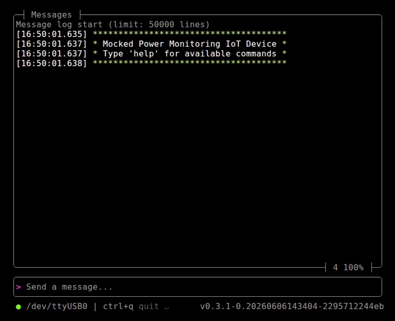

# teaterm - a serial terminal TUI



## Introduction

Teaterm is a simple serial device tool TUI written in GO using the bubbletea framework. It is inspired by tio with a focus on a nice and easy to use user interface.

## Installation

Teaterm can be installed with [go](http://go.dev/doc/install).

Make sure you go bin path is set correctly to use `go install`.
To do so, add the following two lines to your `.bashrc` / `.zshrc` and source it:

```shell
export PATH=$PATH:/usr/local/go/bin
export PATH=$PATH:$HOME/go/bin
```

```shell
source ~/.bashrc
```

Afterwards teaterm can be installed with

```shell
go install github.com/mahlburgc/teaterm@latest
```

## Development

A debug logger can be activated to write debug infos into a log file during teaterm execution.

```shell
git clone https://github.com/mahlburgc/teaterm.git && cd teaterm
export TEATERM_DBG_LOG=1    # enable debug logger
export TEATERM_MOCK_PORT=1  # optional, use a mocked serial port instead of a real one
go run .
```

In a second shell, use tail to see the debug messages.
```shell
tail -f <repo-path>/debug.log
```

## Configuration

Teaterm reads its settings on startup from `~/.config/teaterm/teaterm.toml` (next to the command history `cmdhistroy.conf`).
The file is optional and is not created automatically. All settings are optional, unset values use the default.
If the file contains an invalid value or an unknown setting, teaterm prints an error and exits.

Example with all available settings (values shown are the defaults):

```toml
[cmdhist]
# How the command history behaves when opened with ctrl+r.
#   "popup": ctrl+r opens the history, up/down move the selection,
#            enter copies the selected command into the input and closes the history.
#   "panel": the history is open on start, ctrl+r shows/hides it, it stays open while working,
#            enter sends the input, up/down recall commands into the input (shell-style)
#            and typing filters the history.
mode = "popup"

# Height of the command history.
# Either a number of rows (e.g. 15 or "15") or a percentage of the terminal height (e.g. "30%").
# If not set: 10 rows, but at most a third of the terminal height.
# The message log always keeps a minimum height of 3 rows.
# height = 10

[layout]
# Border style of message log, command history and input.
#   "full":    every section is drawn as a box.
#   "minimal": no side borders, sections are only separated by a single line
#              that holds the section title and info.
borders = "full"
```

| Setting          | Allowed values                | Default                         |
| ---------------- | ----------------------------- | ------------------------------- |
| `cmdhist.mode`   | `"popup"`, `"panel"`          | `"popup"`                       |
| `cmdhist.height` | rows (`15`, `"15"`), `"1%"`..`"100%"` | 10 rows, max 1/3 of terminal |
| `layout.borders` | `"full"`, `"minimal"`         | `"full"`                        |

While the command history is open, its height can be changed during the session with `alt+↑` / `alt+↓`.
These changes are not stored.

## Copy Text from the Message Log

Select text in the message log by pressing the left mouse button and dragging over it.
On release, the selected text is copied to the clipboard and the message log footer shows `copied N chars`.
While dragging, the message log does not scroll on new messages. Dragging beyond the top or bottom edge scrolls the log.

Teaterm copies via the system clipboard and via OSC 52, so at least one of these is needed:

- `wl-copy` (Wayland), `xclip` or `xsel` (X11) installed, or
- a terminal with OSC 52 support (works over SSH). In tmux, enable it with `set -g set-clipboard on`.

## External Editor Support

During a teaterm session you can open an external editor of your choice with the current message log by pressing `ctrl+e`. Make sure your `EDITOR` variable is exported in your shell config file. Otherwise `vim` will be called.

E.g. when using `micro` and `zsh`:

```shell
echo 'export EDITOR="/usr/bin/micro"' >> ~/.zshrc
source ~/.zshrc
```

## Available Features

- list available ports
- easy connection to serial devices
- stable connection with automatic reconnect
- TUI with seperated input, output and command history window
- status bar with current port and connection status
- command history stored over sessions
- mouse support
    - send commands from command history per mouse click
    - scroll message log
    - select text in message log, copied to clipboard on release
- easily open editor with current message log
- timestamp
- create log files
- manual disconnect/reconnect to port from TUI
- auto completion suggestions for send commands based on command history
- fuzzy finder for command history while typing
- only auto scroll on new messages if we are at lowest line
- indicate that we are on lowest line
- scroll indicator for message log
- ctrl + page up / down for faster scrolling
- use ctrl+q for quit
- on ascii view, ignore non ascii characters
- command history as popup or persistent panel with configurable height (see [Configuration](#configuration))

## Planned features

- configurable port settings
- configurable line ending for RX and TX
- (ability to change config during session)
- status bar shows current port settings (e.g. 9600 8N1)
- create different profiles with separate settings, command histories and predefined commands
- possibility to create predefined commands / favorites for faster communication with serial CLIs
- make command history length and message log length configurable
- choose between ascii and hex view
- option to display line ending characters
- use cobra for better cli command handling and flags

## Useful Resources
- https://leg100.github.io/en/posts/building-bubbletea-programs/
- https://github.com/lrstanley/bubblezone
- https://github.com/charmbracelet/bubbletea
- https://github.com/charmbracelet/vhs?tab=readme-ov-file
- https://github.com/spf13/cobra
- https://github.com/charm-and-friends/additional-bubbles?tab=readme-ov-file#additional-bubbles